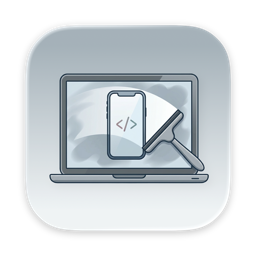
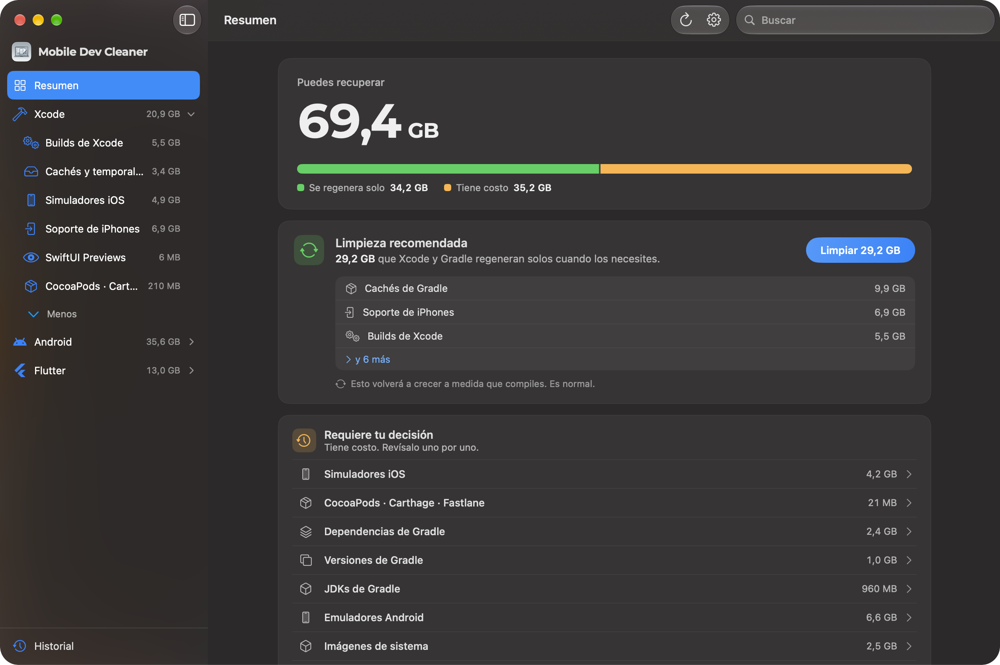

<p align="center">
  
</p>

<h1 align="center">Mobile Dev Cleaner</h1>

<p align="center">
  Recupera el espacio que dejan Xcode, Android Studio y Flutter, sin romper nada.
</p>

<p align="center">
  
  
  
  <a href="LICENSE"></a>
</p>

<p align="center">
  <a href="README.md">English</a> · <b>Español</b>
</p>

<p align="center">
  
</p>

App nativa de macOS que encuentra las cachés, compilaciones, simuladores, emuladores y SDKs que se acumulan en la Mac de un dev mobile, explica qué es cada cosa y las limpia de forma segura. Se siente como **Ajustes del Sistema › Almacenamiento**, no como un "cleaner" agresivo.

## Por qué

Xcode, Android Studio y Flutter reparten compilaciones, cachés, estado de simuladores y toolchains viejos en más de una docena de carpetas, y ninguno limpia lo que deja. Los limpiadores genéricos no conocen estas rutas o borran cosas que todavía necesitas.

Mobile Dev Cleaner conoce las rutas exactas y etiqueta cada elemento según lo que cuesta borrarlo:

| Etiqueta | Significado |
|---|---|
| **Se regenera solo** | Se puede borrar sin problema. La herramienta lo vuelve a crear (cachés, compilaciones, logs). |
| **Tiene costo** | Se puede borrar, pero implica volver a descargar, recompilar lento o perder datos de simuladores. |

Nada se borra hasta que lo revisas.

## Qué limpia

| Herramienta | Categorías |
|---|---|
| **Xcode** | DerivedData (detecta proyectos huérfanos), cachés de Xcode y SwiftPM, dispositivos de prueba, simuladores (limpiar, restablecer o eliminar cada uno), runtimes de simulador, device support, archives, previews de SwiftUI, cachés de CocoaPods / Carthage / fastlane |
| **Android Studio** | Cachés, dependencias, versiones del wrapper y JDKs de Gradle, logs de los daemons de Gradle y Kotlin, cachés de Android, emuladores (limpiar, restablecer o eliminar cada AVD), system images (marca las que ningún emulador usa), NDK / CMake / build-tools / platforms, restos de versiones viejas de Android Studio |
| **Flutter** | `build/` y `.dart_tool/` de cada proyecto en tu carpeta personal, pub cache, caché del SDK de Flutter, versiones de FVM (marca las que ningún proyecto usa) |

## Seguridad

- **Primero revisas.** Cada limpieza abre un resumen de lo que se libera, lo que cuesta cada elemento con costo y, si quieres, los comandos exactos que se van a ejecutar.
- **Papelera por defecto.** Los archivos van a la Papelera; borrar definitivo es opcional.
- **Se bloquea con las herramientas abiertas.** La limpieza espera si Xcode, Simulator, Android Studio, un emulador o Flutter están corriendo.
- **Nunca toca credenciales ni lo esencial del SDK.** Keystores, certificados, provisioning profiles, claves ADB, licencias, `platform-tools`, `cmdline-tools`, backups y runtimes en uso nunca se escanean ni se muestran.
- **Rutas y comandos permitidos.** Un último control rechaza cualquier ruta fuera de las carpetas de desarrollo conocidas y cualquier comando que no sean las llamadas puntuales a `simctl` y `avdmanager` que la app necesita.
- **Tus exclusiones mandan.** Las carpetas que excluyes nunca se seleccionan, ni siquiera en la limpieza recomendada.

## Privacidad

Sin telemetría, sin analíticas, sin acceso a internet. Los escaneos y el historial se quedan en tu Mac.

## Instalación

Todavía no hay descargas listas para instalar. [Compílala desde el código](#compilar-desde-el-código); toma un minuto.

El **Acceso total al disco** es opcional. Sin él funciona todo menos los runtimes de simulador y los proyectos de Flutter dentro de Escritorio, Documentos y Descargas. La app te guía para darlo.

## Uso

1. Abre la app. Escanea al iniciar (se puede desactivar).
2. Empieza por la **Limpieza recomendada**: solo selecciona elementos que se regeneran.
3. Abre una categoría para ver qué es cada elemento, qué pasa si lo borras y si vuelve.
4. Revisa y limpia.

| Atajo | Acción |
|---|---|
| `⌘R` | Escanear de nuevo |
| `⌘1` `⌘2` `⌘3` | Ir a Xcode, Android, Flutter |
| `Esc` | Cancelar una limpieza en curso |

Los planes de limpieza se pueden exportar e importar como JSON, compatibles con el [CLI `mdc`](https://github.com/LeoMogiano/mdc-cli).

## Idiomas

English, Español, Deutsch, Português (Brasil), 日本語, 简体中文.

## Compilar desde el código

Requisitos: Xcode 26, [XcodeGen](https://github.com/yonaskolb/XcodeGen). Sin dependencias de terceros.

```sh
brew install xcodegen
xcodegen generate
open MobileDevCleaner.xcodeproj
```

Correr los tests (Swift Testing; nunca tocan tu carpeta personal real):

```sh
xcodebuild -project MobileDevCleaner.xcodeproj -scheme MobileDevCleaner \
  -destination 'platform=macOS' -derivedDataPath build/dd test
```

El código sigue Clean Architecture por feature. Las convenciones están en [`CLAUDE.md`](CLAUDE.md) y el porqué de las decisiones importantes en [`docs/adr/`](docs/adr/).

## Contribuir

Issues y pull requests son bienvenidos. Para algo más grande que un arreglo, abre primero un issue para acordar el enfoque. Una categoría de limpieza nueva necesita responder claro tres preguntas: qué es, qué pasa si se borra y si vuelve.

## Licencia

[MIT](LICENSE) © 2026 Leo Mogiano.

Xcode y Simulator son marcas de Apple Inc. Android, Android Studio y Flutter son marcas de Google LLC. Este proyecto no está afiliado ni respaldado por Apple ni por Google.
