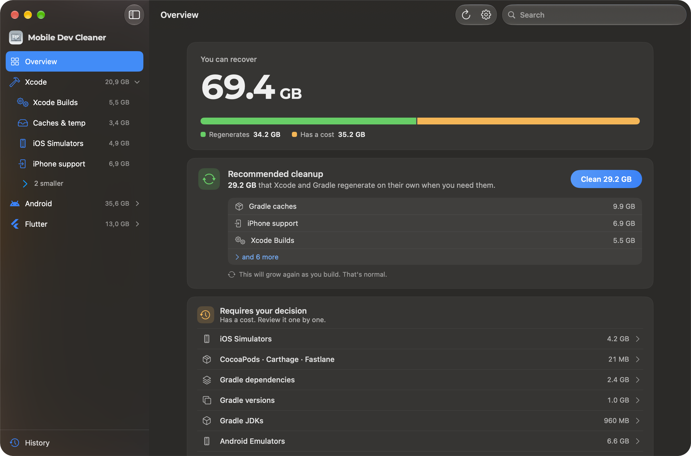

<p align="center">
  
</p>

<h1 align="center">Mobile Dev Cleaner</h1>

<p align="center">
  Reclaim the disk space Xcode, Android Studio and Flutter leave behind — without breaking anything.
</p>

<p align="center">
  
  
  
  <a href="LICENSE"></a>
</p>

<p align="center">
  <b>English</b> · <a href="README.es.md">Español</a>
</p>

<p align="center">
  
</p>

A native macOS app that finds the caches, builds, simulators, emulators and SDKs piling up on a mobile developer's Mac, explains what each one is, and cleans them safely. It feels like **System Settings › Storage**, not like an aggressive "cleaner".

## Why

Xcode, Android Studio and Flutter spread build products, caches, simulator state and old toolchains across more than a dozen folders, and none of them clean up after themselves. Generic cleaners either don't know these paths or delete things you still need.

Mobile Dev Cleaner knows the exact paths and labels every item with what it costs to delete:

| Label | Meaning |
|---|---|
| **Regenerates** | Safe to delete. The tool rebuilds it on its own (caches, build products, logs). |
| **Has a cost** | Works fine to delete, but means a re-download, a slow rebuild or lost simulator data. |

Nothing is deleted until you review it.

## What it cleans

| Tool | Categories |
|---|---|
| **Xcode** | DerivedData (with orphaned projects detected), Xcode and SwiftPM caches, test devices, simulators (clean, reset or delete per device), simulator runtimes, device support, archives, SwiftUI previews, CocoaPods / Carthage / fastlane caches |
| **Android Studio** | Gradle caches, dependencies, wrapper versions and JDKs, Gradle and Kotlin daemon logs, Android caches, emulators (clean, reset or delete per AVD), system images (flags the ones no emulator uses), NDK / CMake / build-tools / platforms, leftovers from old Android Studio versions |
| **Flutter** | `build/` and `.dart_tool/` of every project in your home folder, pub cache, Flutter SDK cache, FVM versions (flags the ones no project uses) |

## Safety

- **Review first.** Every cleanup opens a summary of what will be freed, what each item with a cost will cost, and, optionally, the exact commands that will run.
- **Trash by default.** Files go to the Trash; permanent deletion is opt-in.
- **Blocks while tools are open.** Cleanup waits if Xcode, Simulator, Android Studio, an emulator or the Flutter tool is running.
- **Never touches credentials or SDK essentials.** Keystores, certificates, provisioning profiles, ADB keys, licenses, `platform-tools`, `cmdline-tools`, backups and runtimes in use are never scanned or shown.
- **Allowlisted paths and commands.** A final guard rejects any path outside the known developer folders and any command other than the specific `simctl` and `avdmanager` calls the app needs.
- **Your exclusions win.** Folders you exclude are never selected, not even by the recommended cleanup.

## Privacy

No telemetry, no analytics, no network access. Scans and history stay on your Mac.

## Install

There are no prebuilt downloads yet. [Build it from source](#building-from-source); it takes a minute.

**Full Disk Access** is optional. Without it everything works except simulator runtimes and Flutter projects inside Desktop, Documents and Downloads. The app guides you through granting it.

## Usage

1. Open the app. It scans on launch (you can turn that off).
2. Start with **Recommended cleanup**: it selects only items that regenerate.
3. Open a category to see what each item is, what happens if you delete it and whether it comes back.
4. Review and clean.

| Shortcut | Action |
|---|---|
| `⌘R` | Scan again |
| `⌘1` `⌘2` `⌘3` | Jump to Xcode, Android, Flutter |
| `Esc` | Cancel a running cleanup |

Cleanup plans can be exported and imported as JSON, compatible with the [`mdc` CLI](https://github.com/LeoMogiano/mdc-cli).

## Languages

English, Español, Deutsch, Português (Brasil), 日本語, 简体中文.

## Building from source

Requirements: Xcode 26, [XcodeGen](https://github.com/yonaskolb/XcodeGen). No third-party dependencies.

```sh
brew install xcodegen
xcodegen generate
open MobileDevCleaner.xcodeproj
```

Run the tests (Swift Testing; they never touch your real home folder):

```sh
xcodebuild -project MobileDevCleaner.xcodeproj -scheme MobileDevCleaner \
  -destination 'platform=macOS' -derivedDataPath build/dd test
```

The code follows Clean Architecture by feature. Conventions live in [`CLAUDE.md`](CLAUDE.md) and the reasoning behind key decisions in [`docs/adr/`](docs/adr/).

## Contributing

Issues and pull requests are welcome. For anything larger than a fix, open an issue first so we can agree on the approach. New cleanup categories need a clear answer to three questions: what is it, what happens if it's deleted, and does it come back.

## License

[MIT](LICENSE) © 2026 Leo Mogiano.

Xcode and Simulator are trademarks of Apple Inc. Android and Android Studio are trademarks of Google LLC. Flutter is a trademark of Google LLC. This project is not affiliated with or endorsed by Apple or Google.
